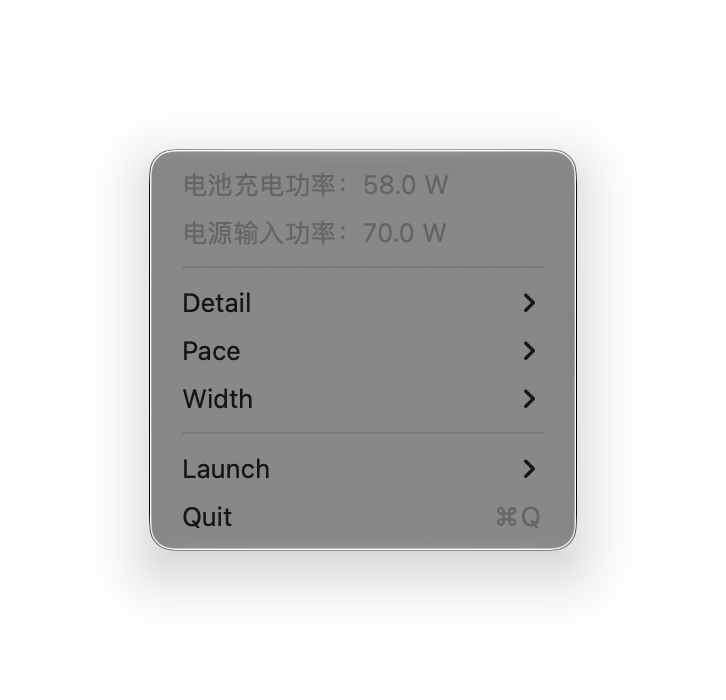

# WattSecPlus

**English** | [简体中文](README.zh-CN.md)

A lightweight macOS menu bar power monitor, based on [beutton/wattsec](https://github.com/beutton/wattsec) by Ben Beutton.

WattSecPlus retains the original native menu and adds just two readings:

- Battery charging/discharging power, estimated as **DC input power − system power**.
- Actual DC power input, rather than the adapter’s rated wattage.

The battery reading is a balance estimate that includes unaccounted conversion losses; it is not a direct battery-terminal measurement. Both sensors are read in the same sampling cycle, but the hardware may update them at different times. Availability depends on the Mac and its SMC sensors.

## Screenshot

<p align="center">
  
</p>

Captured from the actual native menu with demonstration values; no desktop or personal information is included. The example system reading is 12.0 W, so the charging balance is 70.0 − 12.0 = 58.0 W. System power normally appears in the menu bar.

## Download

Download `WattSecPlus-macOS.zip` from [Releases](https://github.com/xiaoyangou/WattSecPlus/releases). Quit any older WattSec/WattSecPlus instance before opening the app. Requires macOS 13 or later. The universal binary includes Apple Silicon and Intel architectures. Builds are ad-hoc signed and not notarized by Apple.

## Settings

- **Detail**: 0, 1, or 2 decimal places for all power readings. The battery estimate subtracts the displayed input/system values so the visible numbers align.
- **Pace**: 1, 3, or 5 seconds for all readings, including while the menu is open.
- **Width**: Dynamic or Fixed menu-bar width.
- **Launch**: Launch at login.

## Automatic readings (1.1.1)

No manual calibration or fixed power offset is used. The app automatically checks Mac-only sources:

1. Prefer `AppleSmartBattery.PowerTelemetryData` input/system values (mW → W) only after both update counters advance at a timely cadence.
2. Reject unchanged, reset, missing or stale telemetry rather than presenting cached data as a live reading.
3. Otherwise take a short paired sampling window of SMC `PDTR`/`PSTR` and average both channels over that same window.

Power rows have no hover popups (1.1.3). Unplugging is detected from system power-source state. The existing Pace and Detail settings still control all visible readings, and battery balance is still **input − system**. The two new power rows remain the only additional metrics.

This reads Mac sensor measurements, not the adapter's screen. It cannot automatically infer an adapter's calibration error, guarantee agreement with an independent meter, or establish instrument accuracy. Some USB-C/adapter voltage/current fields describe negotiated limits; they are deliberately not used as live input watts. Hardware sampling times can still differ. The unpublished 1.1.0 manual-calibration approach is removed; any old offset preference is ignored.

## Adapter-only battery idle (1.1.2)

While an adapter is connected and charging has stopped, the sign of input-minus-system noise is no longer used to declare battery activity. Live signed battery current and the charging flag confirm an idle state. Confirmed idle displays a neutral **battery power: 0 W** while the input/system sensor readings remain untouched.

Two near-zero, not-charging observations confirm idle. During confirmation the battery row shows a neutral dash instead of flashing an estimated charge/discharge value. Current hysteresis uses 20 mA to enter and 60 mA to leave; an exact zero with a stale charging flag requires three confirmations. Unplugging, measurable charging, substantial battery current, or missing state evidence exits idle. This prevents adapter-only idle flicker without masking a battery that is genuinely supplementing the adapter. Idle confirmation follows Pace; precision still follows Detail.

In confirmed idle only, displayed battery power is zero rather than the noisy power-sensor difference, so the display is not forced to satisfy exact power arithmetic in that state. Otherwise the balance remains input minus system. On hardware without a validated live battery-current source, idle is not guessed. The new current reader is verified for Apple Silicon; Intel idle detection still needs a validated implementation.

## Improvements

- Two concise power rows in the existing native menu.
- Invalid or missing readings show unavailable/dash instead of a false zero.
- A neutral battery-power label when the displayed difference is zero.
- Fixed-width layout accommodates precision changes and longer readings.
- Validated SMC responses, bounded payloads, safe float decoding, connection retries, and metadata caching.
- Duplicate/in-flight sampling is coalesced, and unchanged labels are not reassigned.

## Build

With Xcode installed:

```sh
./build.sh
open dist/WattSecPlus.app
```

Or open `WattSecPlus.xcodeproj` in Xcode. The bundle identifier is `io.github.xiaoyangou.WattSecPlus`.

## Tests

```sh
swiftc WattSecPlus/BatteryStatus.swift Tests/main.swift -o /tmp/wattsecplus-power-tests
/tmp/wattsecplus-power-tests
swiftc WattSecPlus/SMC.swift Tests/SMC/main.swift -o /tmp/wattsecplus-smc-tests
/tmp/wattsecplus-smc-tests
swiftc WattSecPlus/TelemetryFreshness.swift Tests/Telemetry/main.swift -o /tmp/wattsecplus-freshness-tests
/tmp/wattsecplus-freshness-tests
swiftc WattSecPlus/BatteryStatus.swift WattSecPlus/SMC.swift WattSecPlus/TelemetryFreshness.swift WattSecPlus/BatteryIdleDetector.swift WattSecPlus/PowerTelemetry.swift Tests/PowerSampler/main.swift -o /tmp/wattsecplus-source-tests
/tmp/wattsecplus-source-tests
swiftc WattSecPlus/BatteryIdleDetector.swift WattSecPlus/BatteryStatus.swift Tests/Idle/main.swift -o /tmp/wattsecplus-idle-tests
/tmp/wattsecplus-idle-tests
python3 Tests/Integration/run.py
```

The data tests cover the difference calculation, rounding, and neutral zero labels. SMC tests use an injected transport for protocol errors, decoding, caching, and reconnection. The macOS integration checks exercise native menu tracking, layout, sampling coalescing, and Pace/Detail settings, restoring test preference changes afterward. Live SMC readings require hardware access. Intel runtime behavior and launch-at-login require separate on-device verification.

## Privacy

The application reads local SMC power sensors. It has no analytics, telemetry, account login, or upload feature. Power readings are not written to a history file. Preferences are stored locally. Connection failures may produce rate-limited system logs. Integration tests print readings locally to the terminal.

## Credits and license

- **Original project: [beutton/wattsec](https://github.com/beutton/wattsec), by Ben Beutton.** WattSecPlus is an independent derivative and is not an official release of the upstream project.
- [exelban/stats](https://github.com/exelban/stats) for the upstream SMC polling implementation.

Distributed under the [MIT License](LICENSE). The original copyright notice is preserved. WattSecPlus adds the power rows, balance calculation, and reliability improvements described above.
